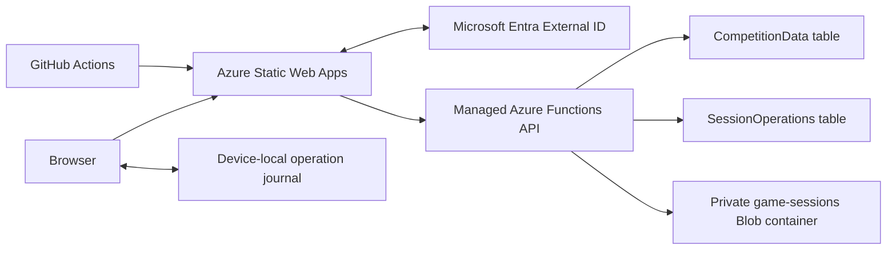

# Architecture

Basketball Stats is a React application backed by Azure Static Web Apps, a managed Azure Functions API, and Azure Storage. The session creator is the master stat recorder; realtime collaboration is not implemented.

## System overview

The browser uses same-origin `/api/v1` endpoints. Azure Static Web Apps handles sign-in and proxies authenticated requests to its managed Functions API. Tables are the authoritative data store; Blob snapshots are secondary checkpoints.

## Frontend and execution modes

Entry point: [src/main.tsx](../src/main.tsx). Routing and mode selection: [src/App.tsx](../src/App.tsx).

| Mode | Purpose | Identity and persistence |
| --- | --- | --- |
| Azure (`VITE_BACKEND_MODE=azure`) | Hosted application | External ID sign-in, approved accounts, Azure storage |
| UI preview (`npm run dev:ui`) | Login-free UI iteration using hosted components | Disposable local identity and in-memory API repository; no Azure access |
| Local demo (`npm run dev`) | Standalone prototype | Demo credentials and browser preferences; live game events do not survive refresh/exit |

The UI preview is restricted to loopback and development mode. Its bootstrap endpoint and identity bypass are not included in production browser assets. Implementation: [dev/ui-preview-plugin.mjs](../dev/ui-preview-plugin.mjs), [src/dev/UiPreview.tsx](../src/dev/UiPreview.tsx), and [preview instructions](../dev/README.md).

### Main frontend components

- [src/CloudPortal.tsx](../src/CloudPortal.tsx): account, competition, game, and session navigation.
- [src/CloudGameTracker.tsx](../src/CloudGameTracker.tsx): session loading, editor lock, setup, clock, capture routes, and save/recovery controls.
- [src/candidates/CandidateConsole.tsx](../src/candidates/CandidateConsole.tsx): tagging and possession entries.
- [src/candidates/ButtonTagging.tsx](../src/candidates/ButtonTagging.tsx): labeled Offense/Defense action workflows. Button actions infer the active side; opposite-side actions transition possessions.
- [src/candidates/ConfigurationTab.tsx](../src/candidates/ConfigurationTab.tsx): tracked statistics and starting five. Tagging is button-only; there is no device mode preference or typing parser.
- [src/styles.css](../src/styles.css): shared local-preview/hosted styling. Desktop game context stays on the left and route content on the right; smaller screens stack.

Other routes provide substitutions, possession matrix, lineup differential, and individual differential. Scores and assists are attributed to actual lineup stints, including same-clock substitutions; historical assist edits retain the possession-end marker as the last event.

Boundary deletion uses `possession.boundary.delete` to merge adjacent same-quarter possessions while retaining events. The reducer retains a single undo snapshot; `possession.boundary.undo` restores it using fresh boundary/possession IDs. Gameplay edits invalidate Undo, while clock-only checkpoints retain it. `game.reset` requires explicit confirmation and fresh IDs, clears gameplay state, and retains roster/configuration with the opening lineup. All three operations use the same revision, journal, authorization, deduplication, and replay rules as stat capture. Historical records remain in the immutable operation log.

Ordinary `event.delete` also retains an authoritative possession snapshot for the latest deletion. `event.undo` restores original order and any linked assist, allocates fresh IDs for removed events, and retains their original clock and lineup attribution. It shares the same one-deletion undo window as boundary deletion; clients cannot supply arbitrary historical events to restore.

Explicit End Possession uses `possession.toggle` with `explicitSide`. It closes even a stat-free possession and records `explicitlyEnded` so later inferred toggles cannot silently reopen it. The client opens the closed possession's auto-saving details dialog; Later dismisses without inventing detail values.

## API and security boundaries

- [api/src/functions.ts](../api/src/functions.ts): Functions HTTP entry.
- [api/src/service.ts](../api/src/service.ts): request routing and application authorization.
- [api/src/auth.ts](../api/src/auth.ts): validates the SWA principal and maps its stable user ID to an approved account.
- [api/openapi.yaml](../api/openapi.yaml): API contract.
- [src/lib/api.ts](../src/lib/api.ts): same-origin browser API client.

**The principal header is trusted only behind the managed SWA proxy.** Do not expose a standalone public Functions endpoint that accepts client-supplied identity headers. Approval and authorization are checked on API requests, not merely in the UI.

Administrators manage schedules and subscriptions. Session access remains scoped to the creator/master and applicable subscription rules: administrator status does not automatically grant access to another master's sessions. Account preferences are user-scoped. Conditional writes protect metadata and preference updates.

Secrets are server-side configuration, never frontend environment variables or committed source. `VITE_BACKEND_MODE` is public build configuration, not a security boundary.

## Session state and durable writes

The same schemas and reducer run in the browser and API:

- [shared/session.ts](../shared/session.ts): session and operation schemas.
- [shared/reducer.ts](../shared/reducer.ts): validated deterministic operation application.
- [src/lib/sessionSync.ts](../src/lib/sessionSync.ts): browser journal, optimistic state, serialized upload, and recovery.
- [api/src/sessions.ts](../api/src/sessions.ts): session authorization, operation commits, replay, and checkpoint coordination.
- [api/src/repository.ts](../api/src/repository.ts): Azure and in-memory storage adapters.

### Write flow

1. The browser creates an operation with a unique operation ID and expected session revision.
2. The shared reducer validates the optimistic result.
3. The operation journal is persisted locally **before** the UI reports local success.
4. A serialized uploader sends the operation through the authenticated API.
5. The API checks authorization, deduplication, expected revision, and state invariants.
6. The operation record and conditional session-head update commit atomically in the same table partition.
7. The browser durably records the acknowledgement and advances its last-saved timestamp.

Retries retain the exact operation envelope. An already committed identical retry is deduplicated; changed payloads or stale competing writes are rejected. Never generate replacement IDs or silently rebase uncertain operations.

### Storage layout

| Store | Role |
| --- | --- |
| `CompetitionData` table | Competition/game metadata, subscriptions, and account preferences |
| `SessionOperations` table | Session heads, initialization records, and authoritative operation history |
| Private `game-sessions` Blob container | Secondary session checkpoints |
| Browser localStorage | Per-account/session outbox and unfinished setup drafts; device tagging preferences |

Sessions can be reconstructed from initialization and operation records. A failed Blob checkpoint does not invalidate an already committed table operation. Conditional Blob writes prevent an older checkpoint overwriting a newer one.

## Concurrency, clock, and recovery

- Web Locks enforce one editor per account/session within a browser origin. Other browsers/devices remain subject to server revision checks; this is not realtime collaboration.
- Offline operations stay in the local journal. A session still requires a connection to load/resume.
- Conflicts, invalid journals, and storage failures have explicit recovery paths; uncertain changes are not silently overwritten. Export pending changes before discard/reload when needed.
- Resume stops the clock. Running clocks checkpoint every ten ticks and before stats, possession changes, and normal exit. Abrupt closure may lose recent uncheckpointed clock time, not acknowledged event operations.
- Browser storage and pending-operation exports are not full cloud backups. Clearing site data or losing a device can lose unsent operations.

## Azure infrastructure and delivery

Current application URL: [https://green-plant-0b0d20b00.6.azurestaticapps.net](https://green-plant-0b0d20b00.6.azurestaticapps.net).

Hosting uses Static Web Apps Standard with managed Functions and custom External ID OIDC. Storage uses Standard LRS, HTTPS/TLS 1.2, no anonymous Blob access, Blob versioning, and 14-day Blob/container soft delete.

Infrastructure entry points:

- [infra/main.bicep](../infra/main.bicep): orchestration.
- [infra/resources.bicep](../infra/resources.bicep): full resource provisioning.
- [infra/data.bicep](../infra/data.bicep): private container and tables under retained resources in adoption mode.
- [infra/appsettings.bicep](../infra/appsettings.bicep): authoritative secure application settings.

Adoption mode avoids replacing existing hosting/storage roots. Infrastructure uses GitHub-to-Azure workload identity federation scoped to the app resource group. Identity bootstrap resources are retained separately from app decommission targets.

### Pipelines

- [CI](../.github/workflows/ci.yml): builds and regression checks.
- [Application deployment](../.github/workflows/azure-deploy.yml): main push/manual deployment, Azure-mode frontend, rendered OIDC configuration, prebuilt managed API, and anonymous health check.
- [Infrastructure preview/apply](../.github/workflows/azure-infrastructure.yml): reviewed preview and protected apply.
- [Read-only infrastructure verification](../.github/workflows/azure-verify-infrastructure.yml): ownership validation and sanitized what-if.
- [Decommission](../.github/workflows/azure-decommission.yml): explicit preview-first keep-data/delete-data lifecycle.

Routine production app deployments are main-only without manual reviewer approval. Infrastructure/decommission actions retain protected review. Lifecycle workflows share a concurrency group. Anonymous health confirms service reachability, not sign-in or storage readiness.

No destructive decommission/recreation has been verified. Resource deletion requires fresh explicit authorization; deleting an entire storage account is not protected by Blob soft delete. See [operational setup and lifecycle notes](../README.md).

## Tests and current limits

Frontend tests cover capture, metrics, assistants/score linkage, operation journals, and isolated UI-preview integration. API tests cover authorization, state validation, atomicity, deduplication, concurrency, checkpoints, and contracts. Infrastructure tests cover configuration, ownership, preview validation, and deletion guards.

Basic hosted sign-in and cloud save/resume have been verified. Realtime collaborators/invitations, comprehensive hosted offline/conflict/cross-user scenarios, and destructive full recreation remain outside the verified pilot scope.